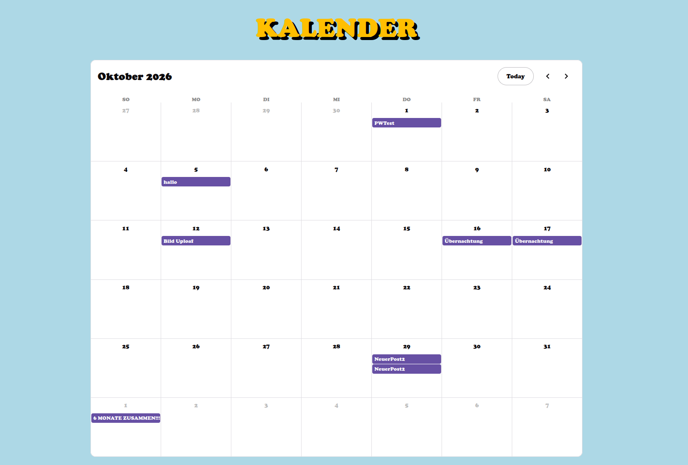
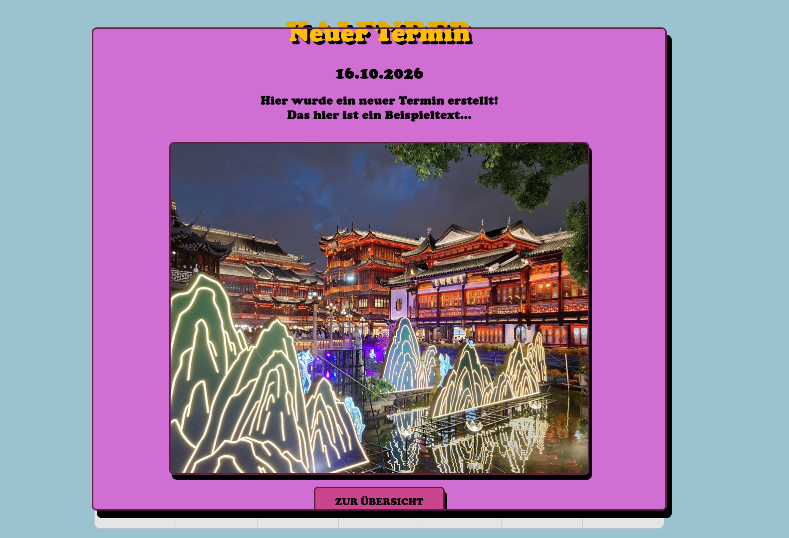

# Calendar-App
Simpler Kalender mit *fullcalendar* und eigener API. 
 

 
## Termin-API
Zur Verwaltung der Termine, wird eine simple Express-API in *server.js* verwendet. 
Darin können per GET-Request alle Termine in JSON Format angefragt werden, die daraufhin angezeigt werden können. 
Per POST-Request können neue Termine inklusive Bild hinzugefügt werden.

## index.html
Mit '*simplecalendar* wird der Kalender angezeigt. 
Beim Klick auf ein Termin wird ein Pop-Up Fenster geöffnet, dass alle Daten des Termins und Bild anzeigt.
